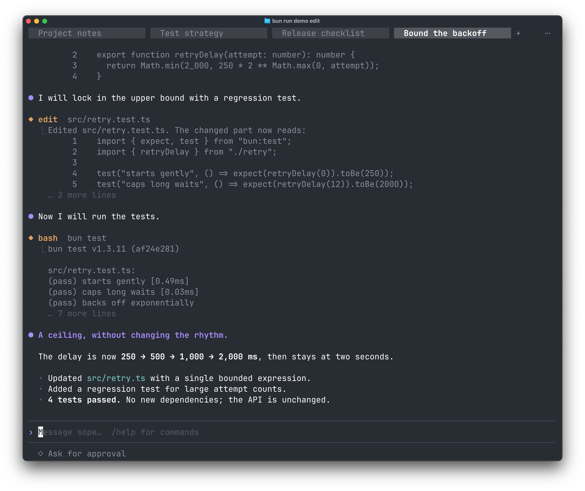

<h1 align="center">sope</h1>

<p align="center">
  <strong>An agent library you can embed.<br>A terminal workspace you can make your own.</strong>
</p>

<p align="center">
  C11 · C ABI · Bun / TypeScript · MIT
</p>

<p align="center">
  <a href="#get-started">Get started</a> ·
  <a href="#a-place-to-work">The TUI</a> ·
  <a href="#bring-the-agent-to-your-app">Embed</a> ·
  <a href="docs/README.md">Documentation</a>
</p>

---

sope is a small, embeddable agent library written in C. Give it a model and a task; it runs the conversation, calls tools, coordinates subagents, and streams events back to your application. Any language with FFI support can use the same public interface.

The included `sope` executable puts that library to work in a full-screen terminal: persistent sessions, readable tool output, and changes you can inspect before approving.

## A small core, ready to work

| Capability | What it gives you |
|---|---|
| **One interface** | A C ABI for your application, with Bun/TypeScript bindings included. |
| **Useful tools, built in** | Read, edit, search, run commands, and fetch pages. Register your own tools when you need more. |
| **Concurrency without dedicated threads** | A shared pool runs agents and parallel tool calls; waiting for a model or child agent releases the worker. |
| **Context that carries forward** | Save and restore history, attach images, and compact long conversations. |
| **Your model, your host** | Connect an OpenAI-compatible endpoint. The host decides permissions, session locations, and how events reach its UI. Durable storage is built into libsope. |

## Get started

From a source checkout:

```sh
bun install
bun run build:native
bun scripts/demo.ts tour
```

The demo runs the real TUI and tools against a scripted local model. It needs no API key and uses a disposable project.

For everyday work, [configure your model](docs/guide/quickstart.md) and run:

```sh
bun run tui
bun run tui -- "Explain how requests flow through this project."
```

Prefer a release archive? It includes a single `sope` executable with libsope embedded:

```sh
tar xzf sope-0.3.0-darwin-arm64.tar.gz
sope-0.3.0-darwin-arm64/install.sh
```

[Installation and first steps →](docs/guide/quickstart.md)

## A place to work

The TUI keeps the work in view: a conversation in the center, independent sessions above, and your next message below. It is written from scratch and uses the same ABI as an embedded application.

[](docs/assets/tui-edit.png)

*Four sessions, one workspace. Captured in Ghostty with scripted English conversations, real file edits, and four passing tests. Click to view at full resolution.*

**Follow the work.** Streamed Markdown, code, task lists, and foldable tool output keep long conversations readable. Subagents report their progress alongside the main conversation.

**See the change first.** Edit approvals show a syntax-highlighted diff with line numbers. Choose Ask for approval, Approve for me, or Full access, and switch modes with `Shift+Tab`.

**Keep your place.** Sessions run independently and restore from SQLite, including the model's history. Paste an image, switch models, or compact the context without losing the visible conversation.

| Try it | What it shows |
|---|---|
| `bun scripts/demo.ts tour` | A calm walkthrough of a small codebase, with file discovery and source reading. |
| `bun scripts/demo.ts edit` | A focused change: inspect the code, approve the diff, add a regression test, and run it. |
| `bun scripts/demo.ts review` | Two subagents inspect behavior and test coverage in parallel, then report back. |

Each interactive demo opens alongside three prepared conversations, so you can explore the session tabs immediately. Responses are scripted locally; the TUI and tools execute normally.

[Explore the terminal →](docs/guide/terminal.md) · [Reproduce the demos →](docs/guide/demos.md)

## Bring the agent to your app

The library handles the agent loop. Your application handles the experience.

```c
#include <sope.h>
#include <stdio.h>

int main(void) {
    sope_agent_t *agent;
    if (sope_agent_new(&agent) != SOPE_OK) return 1;

    /* The default mock provider works offline. */
    sope_send(agent, "hello", 5, NULL);

    sope_event_t event = { .size = sizeof event };
    while (sope_poll(agent, &event, -1) == 1) {
        if (event.type == SOPE_EVENT_TEXT_DELTA)
            fwrite(event.data, 1, event.data_len, stdout);
        if (event.type == SOPE_EVENT_TURN_END && event.agent_id == 0)
            break;
    }
    sope_agent_free(agent);
    return 0;
}
```

Switch the provider to `openai` and set your model, endpoint, and API key for a live agent. Built-in tools request approval through `SOPE_EVENT_PERMISSION`; answer with `sope_permit`, or set a host policy. Integrate `sope_agent_fd` into an event loop when blocking polling does not fit your application.

[C ABI reference](docs/abi.md) · [C examples](examples/) · [Bun / TypeScript bindings](bindings/js/)

## Further reading

- [Configuration](docs/guide/configuration.md) — models, permissions, storage, and terminal settings.
- [Development](docs/development.md) — builds, tests, and a map of the source tree.
- [Releases](docs/release.md) — packaging and ABI compatibility.
- [Changelog](CHANGELOG.md) — what has changed.

MIT licensed. See [LICENSE](LICENSE).
